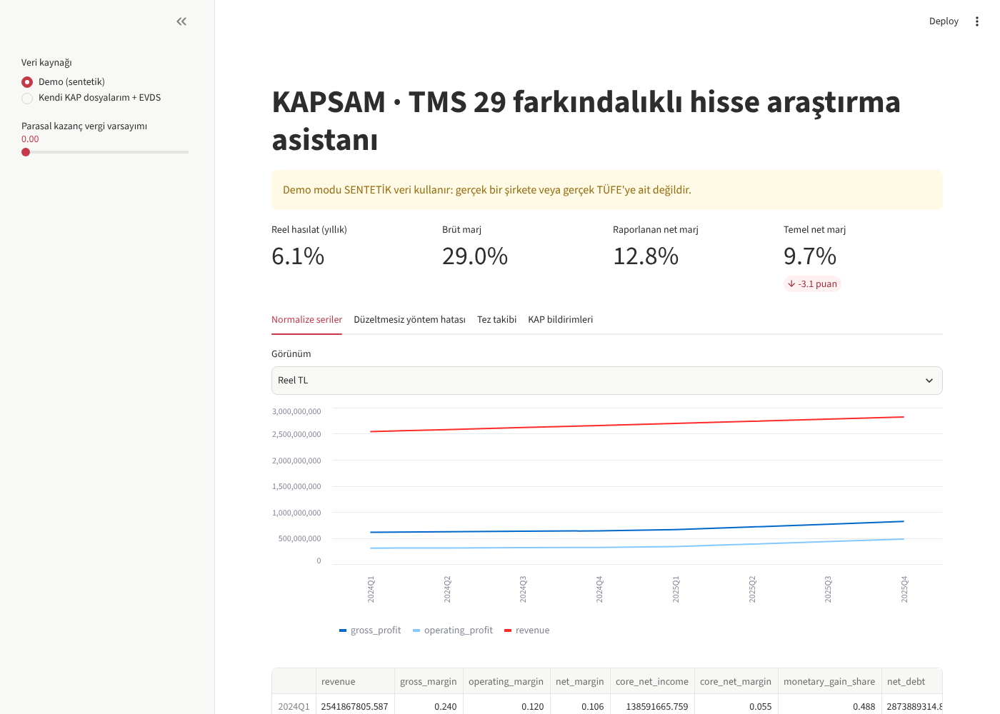
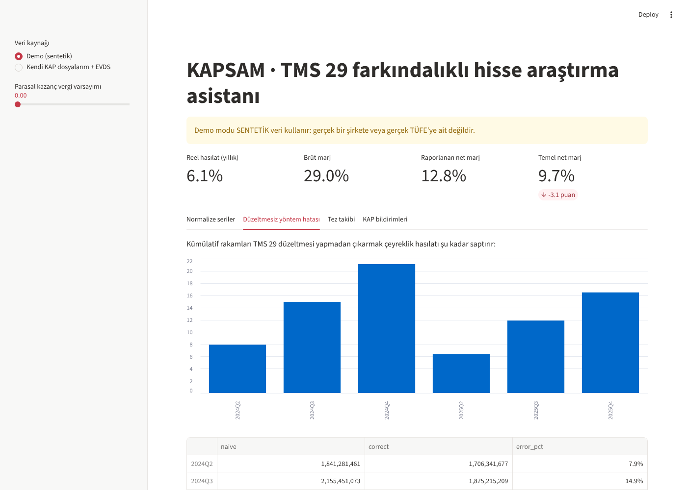
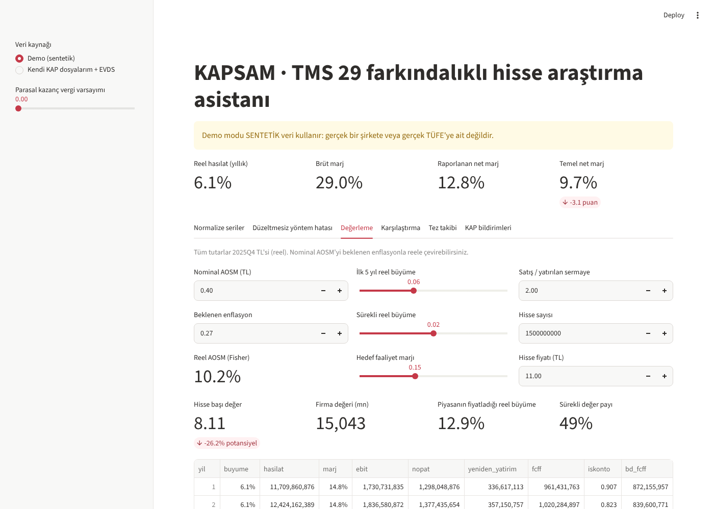
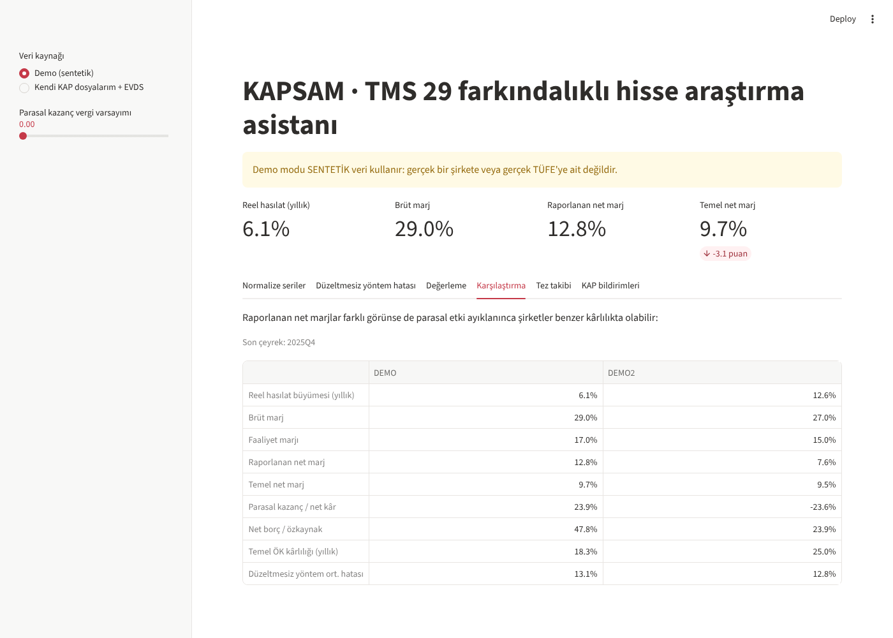
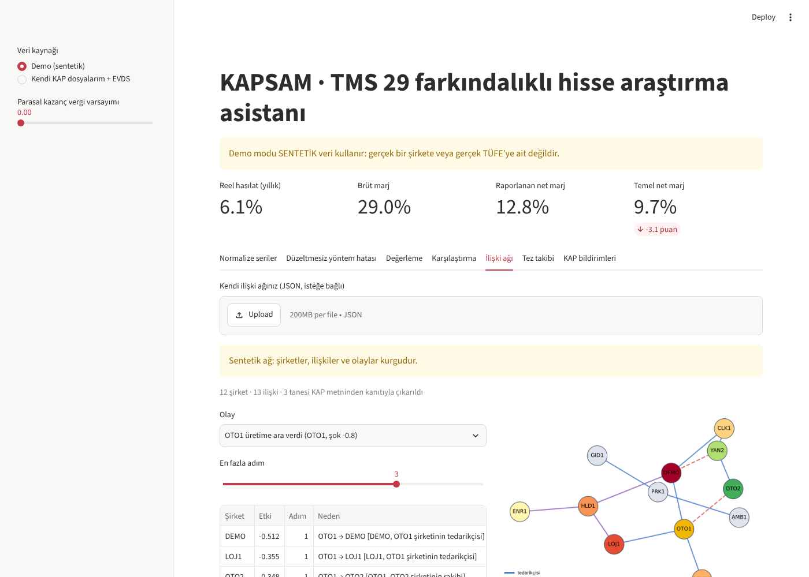

# KAPSAM

[](https://github.com/serhanyokus/kapsam/actions/workflows/tests.yml)

**KAP bildirimlerini ve TMS 29 enflasyon muhasebesini anlayan, yapay zekâ destekli hisse araştırma asistanı.**

Turkcell *Yarının Teknoloji Liderleri 2027*: Fintek ve Dijital Ticaret teması.



## Hangi sorunu çözüyor?

2023 sonundan beri Borsa İstanbul şirketleri finansal tablolarını **TMS 29 (IAS 29)** ile enflasyona göre düzelterek yayımlıyor. Bu durum analistlerin günlük işini üç noktada bozuyor:

1. **Her rapor farklı bir TL ile yazılıyor.** Raporlar, karşılaştırmalı dönemler dahil, raporlama tarihinin satın alma gücüyle sunuluyor.
2. **Çeyreklik rakam basit çıkarmayla bulunamıyor.** 9 aylık rakamdan 6 aylık rakamı doğrudan çıkarmak sonucu sistematik olarak şişiriyor. Demo verisinde bu hata %6 ile %21 arasında çıkıyor (aşağıya bakın).
3. **Kârın önemli kısmı operasyondan gelmeyebiliyor.** *Net parasal pozisyon kazancı* kârı şişirebiliyor.

KAPSAM bu düzeltmeleri otomatik ve denetlenebilir biçimde yapıyor. Düzeltilmiş verinin üzerine **enflasyonla tutarlı bir değerleme** kuruyor: reel İNA, ters İNA ("piyasa ne kadar büyüme fiyatlıyor?") ve çarpanlar. Ayrıca KAP bildirimlerini sınıflandırıp önem skoru veriyor ve analistin yatırım tezini KPI'larla takip ediyor.

Tek komutla bir şirket için **yazdırılabilir araştırma notu (HTML)** ve **formülleri canlı Excel modeli** üretiyor. Örnekler: [`docs/ornek_cikti`](docs/ornek_cikti).



### Değerleme ve karşılaştırma



Sentetik örnekte iki şirketin raporlanan net marjı %12,8 ve %7,6. Parasal etki ayıklanınca ikisinin de temel marjı %9,5 civarında: biri parasal kazanç, diğeri parasal kayıp yazıyor. Düzeltme yapılmadan bakan bir analist yanlış şirketi "daha kârlı" sanar.



### Bilgi grafiği: bir bildirim başka kimleri etkiler?

Bir KAP bildirimi yalnızca açıklayan şirketi etkilemez. KAPSAM, şirketler arasındaki tedarik, ortaklık, grup ve rekabet ilişkilerini bir ağda tutar ve olayın etkisini bu ağ üzerinde yayar. Her sonuç, hangi ilişki zinciriyle geldiğini gösterir:

```
Olay: OTO1 üretime ara verdi (-0.80)
  DEMO   -0.512  OTO1 → DEMO [DEMO, OTO1 şirketinin tedarikçisi]
  OTO2   +0.348  OTO1 → OTO2 [OTO1, OTO2 şirketinin rakibi]
  HLD1   -0.239  OTO1 → DEMO → HLD1 [HLD1, DEMO şirketinin ortağı (%55)]
```

İlişkiler KAP metinlerinden kanıt cümlesiyle çıkarılır ("… ile tedarik sözleşmesi imzalanmıştır", "… şirketimiz sermayesindeki %55 oranında pay"). Benzer şirket önerisi yakınlığa değil **ağdaki role** dayanır: aynı holdingin enerji şirketi yakındır ama benzer değildir.

| Sıralama yöntemi (sentetik vakalar, k=5) | P@5 | R@5 | MAP | nDCG@5 |
|---|---|---|---|---|
| Yalnızca açıklayan şirket (bugünkü pratik) | 0,20 | 0,25 | 0,25 | 0,40 |
| Sektör okuması | 0,30 | 0,36 | 0,36 | 0,51 |
| Kişiselleştirilmiş PageRank | 0,73 | 0,90 | 0,94 | 0,94 |
| TransE gömme | 0,77 | 0,93 | 0,95 | 0,97 |
| **KAPSAM ağ yayılımı (açıklamalı)** | **0,77** | **0,93** | **0,94** | **0,97** |

Eşleştirilmiş bootstrap ile: KAPSAM'ın sektör okumasına üstünlüğü anlamlı (nDCG farkı +0,45, %95 GA [+0,38, +0,53]). Kişiselleştirilmiş PageRank'e karşı fark ise 6 olayla **anlamlı değil**. Buradan çıkan sonuç: değerin çoğu ağın kendisinden geliyor. KAPSAM'ın yayılım modelini öne çıkaran şey, her sonucu bir ilişki zinciriyle **açıklayabilmesi**. İlişki katsayıları elle belirlenmiş değerlerle başlar; geçmiş olaylardaki fiyat tepkileri biriktikçe `models.calibrate` ile veriden öğrenilir.

> Bu tablo sentetik ağ ve elle belirlenmiş "etkilenen şirket" listeleriyle üretilmiştir; yöntemin çalıştığını gösterir, gerçek performansı kanıtlamaz. Gerçek veride doğrulama `graph.event_study` ile yapılır: ağın öngördüğü şirketlerde olay etrafındaki kümülatif anormal getirinin (CAR) anlamlı olup olmadığı ölçülür.

Kendi sıralama modelinizi eklemek için: [docs/kendi_modelin.md](docs/kendi_modelin.md)



## Gerçek veriyle ilk bulgu: BİM (BIMAS)

BİM'in 2025/09 – 2026/09 dönemi beş raporu, gerçek TÜFE ve TCMB kurlarıyla işlendi (kaynaklar ve notlar: [`data/gercek/KAYNAKLAR.md`](data/gercek/KAYNAKLAR.md); not: [`docs/gercek_ornek`](docs/gercek_ornek)).

| | Düz fark (9A − 6A) | TMS 29 ile tutarlı | Fark |
|---|---|---|---|
| 2026 3. çeyrek ana ortaklık net kârı | **10,39 mlr TL** (basında çıkan rakam) | **9,51 mlr TL** | %9,2 |
| 2026 3. çeyrek hasılat | 245,7 mlr TL | 219,3 mlr TL | %12,0 |
| 2025 4. çeyrek hasılat | 231,2 mlr TL | 202,2 mlr TL | %14,3 |

- Basında 3. çeyrek net kârı olarak verilen rakam, 9 aylık ile 6 aylık kârın düz farkına birebir eşit. Yani enflasyon düzeltmesi yapılmamış (şirketin KAP'taki kendi 3 aylık sütunuyla teyit edilmeli).
- 2026'nın ilk 9 ayında net parasal pozisyon kazancı (22,2 mlr TL), net kârın (26,4 mlr TL) %84'ü kadar. Perakendede bu kazanç büyük ölçüde tedarikçi kredisinden (negatif işletme sermayesi) gelir ve ekonomik bir getiridir, ama faaliyet kârında görünmez.
- Ters İNA: %10 reel sermaye maliyeti ve %3 reel büyümeyle, 402,50 TL'lik fiyat yaklaşık **%8,9 kalıcı faaliyet marjı** fiyatlıyor; TMS 29 sonrası son 12 ay faaliyet marjı **%2,9**. Bu fark analistin tartışması gereken asıl soru: amortisman etkisi ve parasal kazanç düzeltildiğinde BİM'in ekonomik marjı nedir?

## Tüm BIST: her hisse, her gün

KAPSAM borsada işlem gören **tüm hisseler** için çalışır. Kimse liste tutmaz: evren her çalıştırmada İş Yatırım "Temel Değerler ve Oranlar" sayfasından (kod, ad, sektör, kapanış, piyasa değeri) yenilenir ve `config/bist_evren.csv` olarak saklanır. Kaynağa ulaşılamazsa son kayıtlı liste kullanılır.

| Tablo türü | Kimler | Nasıl analiz edilir |
|---|---|---|
| `sanayi` | Banka ve sigorta dışındaki herkes (GYO, holding, aracı kurum dahil) | TMS 29 satırı varsa: çeyrek = YB − önceki YB × TÜFE oranı; parasal kazanç ayrıştırma; reel İNA ve ters İNA |
| `sanayi` (nominal) | Net parasal pozisyon satırı olmayanlar (ör. fonksiyonel para birimi USD) | Düz fark; tarama notunda işaretlenir |
| `banka` | Bankalar (BDDK biçimi) | TMS 29 uygulanmaz → düz fark doğrudur. Net faiz + ücret/komisyon geliri, karşılık / net faiz geliri, kredi/mevduat, PD/DD, F/K, ÖK kârlılığı |
| `sigorta` | Sigorta ve emeklilik (SEDDK biçimi) | Düz fark. Brüt/net prim, saklama oranı, teknik denge, PD/DD, F/K, ÖK kârlılığı |

**Akıllı zamanlama.** Şirketler çeyrek bitiminden sonra en geç 75 gün (yıllık rapor 100 gün) içinde rapor açıklar. KAPSAM her hisse için en son hangi dönemin kayıtlı olduğunu ve en son ne zaman bakıldığını `data/gercek/kontrol.json` içinde tutar. Yeni rapor gelemeyecek hisseye istek atılmaz. Rapor penceresi açıkken (çeyrek bitiminden 25 gün sonra başlar) her hisseye 3 günde bir bakılır. Bir çalıştırmada en fazla `gunluk_limit` (varsayılan 150) hisse kontrol edilir: önce takip listesi, sonra hiç bakılmamışlar, sonra en eski kontrol. Böylece ~600 hissenin tamamı ilk hafta içinde dolar ve sonra yalnızca gerektiğinde güncellenir.

```bash
python -m kapsam.cli guncelle                     # evren + makro + fiyat + tablolar + notlar + tüm BIST taraması
python -m kapsam.cli analiz AKBNK                 # tek hisse: banka → finansal sektör notu; sanayi → TMS 29 + İNA + Excel
python -m kapsam.cli tarama                       # kayıtlı tüm şirketler için karşılaştırmalı tarama (CSV)
```

Çıktılar: `docs/rapor/tarama.html` (aranabilir, sıralanabilir tüm BIST tablosu), `docs/rapor/tarama.csv`, takip listesi için şirket notları. Panoda **Gerçek veri → Görünüm: Tüm BIST tarama** sekmesi tür ve sektöre göre süzer.

Kaynak her hisse için yalnızca son 5 dönemi gösterir; KAPSAM eski dönem dosyalarını ezmediği için geçmiş zamanla birikir. Kaynakların kullanım koşullarına uyun (istekler arası bekleme vardır); ticari kullanımda lisanslı veri sağlayıcıya geçin.

İlk gerçek tarama (8 şirket, 18.11.2026):

| Hisse | Son dönem | Düz fark hatası: hasılat | Düz fark hatası: net kâr | Parasal kazanç / net kâr (YB) | Not |
|---|---|---|---|---|---|
| ARCLK | 2026/09 | %13,5 | −%1,4 | – | zararda; parasal kazanç zararı küçültüyor |
| FROTO | 2026/09 | %12,3 | %7,8 | %88 | |
| BIMAS | 2026/09 | %12,0 | %9,2 | %84 | |
| TCELL | 2026/09 | %11,6 | %9,7 | %86 | |
| MGROS | 2026/09 | %11,0 | %1,7 | %476 | parasal kazanç olmasa yılbaşından beri zarar |
| ULKER | 2026/06 | %10,4 | %9,4 | %75 | |
| ASELS | 2026/09 | %9,8 | %8,2 | −%30 | net parasal varlık: enflasyondan kayıp yazıyor |
| TUPRS | 2026/06 | %5,3 | %0,6 | −%7 | net parasal varlık: enflasyondan kayıp yazıyor |

**Sonuç:** Kümülatif rakamları enflasyon düzeltmesi yapmadan çıkarmak, son çeyrek hasılatını **her şirkette %5–14** şişiriyor. Turkcell, Ford Otosan ve BİM'de yılbaşından beri net kârın %84–88'i kadar net parasal pozisyon kazancı var. Migros'ta bu kazanç olmasa yılbaşından beri zarar var. Aselsan ve Tüpraş ise ters yönde: net parasal varlık taşıdıkları için enflasyondan kayıp yazıyorlar.

## Her hisse aynı ayrıntıda

Takip, tüm listelerde ve tüm hisselerde aynı ayrıntı düzeyindedir. KAP tablosu olan her şirket için her gün şunlar üretilir:

- **Not** (`docs/rapor/HİSSE.html`) ve **Excel** (`HİSSE_model.xlsx`). Not türü şirkete göre değişir:
  - **Sanayi şirketleri:** TMS 29 düzeltmeli reel İNA, ters İNA, duyarlılık, çarpanlar ve formüllü model.
  - **Banka ve sigorta:** finansal sektör notu (PD/DD, F/K, özkaynak kârlılığı) ve veri çalışma kitabı.
  - **İNA'ya uygun olmayan şirketler** (hasılatı olmayan holding ve GYO): aynı TMS 29 analizi, çarpanlar ve veri çalışma kitabı.
- **Piyasa riski bölümü:** Her notta bulunur. Reel ve USD getiri, oynaklık, beta, VaR/ES, en büyük düşüş ve en çok birlikte hareket edilen hisseleri içerir.
- **Eksik veride son 12 ay:** Çeyrekleri eksik ya da 6 ayda bir rapor veren şirketlerde son 12 ay, kümülatif raporlardan hesaplanır (YB + önceki yıl − önceki yıl aynı dönem, TÜFE ile).

Tarama sayfasındaki her kod kendi notuna bağlanır. İlk tam çalıştırma 607 şirket için not ve Excel üretti; dağılım 572 İNA, 25 finansal, 10 temel; hata 0.

**Depolama.** Notlar, Excel modelleri ve tam matrisler her gün yeniden üretilir (~100 MB). Bunlar ana dala değil, her çalıştırmada sıfırdan yazılan **`rapor` dalına** yayımlanır, böylece depo büyümez. Ana dalda veriler (KAP tabloları, fiyatlar, TÜFE, kur) ve özet tablolar (`tarama`, `risk_ozet`, takip listesi matrisleri, durum sayfası) tutulur. Notları tarayıcıda açmak için: **Settings → Pages → Branch: `rapor`, klasör: `/ (root)`**. Sayfalar `https://<kullanıcı>.github.io/kapsam/` adresinde yayımlanır.

## Risk, korelasyon ve kovaryans (tüm BIST)

KAPSAM borsadaki **tüm hisselerin** (~629) günlük fiyatını takip eder. Fiyatlar 2022'den bu yana, bölünme ve bedelsize göre düzeltilmiştir; `data/gercek/fiyat/YYYY.csv` dosyalarında yıllara bölünerek saklanır. Her gün yalnızca içinde bulunulan yılın dosyası değişir. Son 252 işlem günü için `docs/rapor/risk/` klasöründe şunlar üretilir:

| Çıktı | İçerik | Sıklık |
|---|---|---|
| `risk_ozet.csv` | Her hisse için: yıllık getiri (nominal, **reel** TÜFE'ye göre, **USD**), yıllık oynaklık, aşağı yön oynaklığı, beta ve BIST 100 korelasyonu, özgün (şirkete özgü) oynaklık, sistematik risk payı (R²), en büyük düşüş, günlük VaR95/ES95, çarpıklık, basıklık, ortalama korelasyon, en çok birlikte hareket ettiği 3 hisse | Günlük |
| `takip_korelasyon.csv`, `takip_kovaryans.csv` | Takip listesi (BIST-30+) matrisleri | Günlük |
| `sektor_korelasyon.csv` | Sektörler arası ve sektör içi ortalama korelasyon | Günlük |
| `korelasyon_tum.csv.gz`, `kovaryans_tum.csv.gz` | Tüm hisseler, örnek matrisler (çift bazında ortak gözlem) | Günlük |
| `kovaryans_ledoit_wolf.csv.gz` | **Tüm hisseler** (yeni halka arzlar dahil) için Ledoit–Wolf küçültülmüş kovaryans; eksik veride çift bazında kovaryans + küçültme + pozitif tanımlı izdüşüm, portföy hesabına uygun | Günlük |

`risk/index.html` sayfası aranabilir ve sıralanabilir risk tablosunu, takip listesinin kümelenmiş korelasyon ısı haritasını ve sektör korelasyonunu gösterir. Panoda **Gerçek veri → Görünüm: Risk ve korelasyon** seçilince istenen hisseler için korelasyon ve kovaryans matrisi ile eşit ağırlıklı portföy oynaklığı hesaplanır. `python -m kapsam.cli risk` kayıtlı fiyatlardan her şeyi yeniden üretir. En az 20 işlem günü verisi olan her hisse dahildir; 120 günden azında risk tablosunda 'Güvenilirlik: düşük' yazar. Tüm piyasa taraması (`tarama.csv`) ayrıca reel getiri, oynaklık, beta ve en büyük düşüş sütunlarını içerir. Olay çalışması da tüm hisselerin fiyatını kullanır.

## Olay çalışması ve gerçek ilişki ağı

Takip listesi **BIST-30** (Ekim–Aralık 2026) ile Arçelik ve Ülker'den oluşur (32 hisse). Bu hisseler için her gün fiyat çekilir, sanayi şirketlerine TMS 29 notu ve Excel modeli, banka ve sigortacılara finansal sektör notu üretilir.

**Olaylar** (`config/takip.json` → `olaylar`): 2025–2026 arasından 25 gerçek KAP açıklaması. Örnekler: THY'nin 225 Boeing siparişi, Turkcell'in 5G lisansı, ASELSAN'ın 1,1 milyar USD ihracatı, Koç'un Tüpraş pay satışları, Arçelik'in Hitachi ortaklığından çıkışı, Şişecam'a Rekabet cezası. Her olayın KAP ya da haber kaynağı ve açıklama saati kayıtlıdır. 18:10'dan sonraki açıklamalarda 0. gün ertesi işlem günüdür. Olay çalışması, BIST 100'e göre piyasa modeliyle [-1,+3] günlük kümülatif anormal getiriyi (CAR) ve t istatistiğini hesaplar. Ardından beklenen yönle karşılaştırır.

**İlişki ağı** (`data/gercek/ag.json`): 16 ortaklık bağı ve oranları, KAP ortaklık tablolarına dayanır. Örnekler: Koç → Tüpraş, Ford Otosan, Tofaş, Arçelik, Yapı Kredi; Sabancı → Akbank; İş Bankası → Şişecam; Varlık Fonu → THY, Turkcell, Türk Telekom; OYAK → Erdemir; Anadolu Grubu → Anadolu Efes, Migros. Bunlara bir tedarik bağı (TAV/Havaş → THY), analist tanımlı rakiplikler (THY–Pegasus, BİM–Migros, Turkcell–Türk Telekom, Ford Otosan–Tofaş, Erdemir–Kardemir) ve sektör benzerliği eklenir. Bir olayın şoku ağda yayılır, ağın öngördüğü bağlantılı şirketlerin gerçek tepkisi de ölçülür.

İlk sonuç (25 olay): olay şirketlerinde anormal getirinin yönü beklentiyle yaklaşık yarı yarıya uyuşuyor ve hiçbir tekil olay %5 düzeyinde anlamlı değil. Bu sonuç, büyük şirketlerde KAP açıklamalarının çoğunun önceden fiyatlandığını ya da günlük oynaklık içinde kaybolduğunu gösteriyor. En büyük tepki, Koç'un Tüpraş payı satışında görüldü (yaklaşık −%8). Yeni olay eklemek için tek satır yeter.

## Modüller

| Modül | Dosya | Ne yapar |
|---|---|---|
| Risk ve bağımlılık | `kapsam/risk.py` | Log getiri, oynaklık, beta, VaR/ES, en büyük düşüş; örnek ve Ledoit–Wolf kovaryans; sektör korelasyonu; kümelenmiş ısı haritası; yıllara bölünmüş fiyat deposu |
| Hisse evreni | `kapsam/data/universe.py` | Tüm BIST hisselerinin kodu, adı, sektörü, kapanışı ve piyasa değeri; sektörden tablo türü (sanayi / banka / sigorta) |
| Tablo kaynağı | `kapsam/data/sources.py` | Herhangi bir hisse için gelir tablosu, bilanço ve nakit akışı okur; sanayi, banka (BDDK) ve sigorta (SEDDK) biçimlerini tanır; yalnızca yeni dönemleri kaydeder; TMS 29 uygulamayan şirketleri işaretler |
| Veri içe aktarma | `kapsam/data/statements.py` | Gerçek KAP Excel düzenini okur: başlık satırları, dipnot sütunu, "Cari Dönem 01.01.2025 - 30.09.2025" gibi başlıklar, çok sayfalı dosyalar (bilanço, gelir tablosu, nakit akış), Türkçe ve İngilizce kalem adları, "3 Aylık" sütunları. İndirilen dosyanın dönemini kendisi bulur (`kap-ekle`) |
| Makro veri | `kapsam/data/evds.py` | TCMB EVDS API'sinden TÜFE (`TP.FG.J0`) ve USD/TRY (`TP.DK.USD.A.YTL`) verisini çeyrek sonuna indirger |
| **TMS 29 motoru** | `kapsam/normalize/tms29.py` | Kümülatiften çeyreğe ayrıştırma, reel (baz tarih) seri, TMS 21 par. 42'ye göre USD çevrimi, parasal kazançtan arındırılmış temel kâr, KPI'lar |
| Sayısal doğrulama | `kapsam/validate.py` | Bilanço denkliği, brüt kâr kimliği ve **KAP'ın kendi 3 aylık rakamlarıyla çapraz kontrol** (KAPSAM'ın kümülatiften hesapladığı çeyrek, KAP'ın yayımladığıyla %0,5 içinde mi?); özetlerdeki her sayının kaynak metinde geçtiğini doğrulama |
| Bildirim sınıflandırıcı | `kapsam/ai/classifier.py` | 11 KAP bildirim kategorisi, yön (+/−), tutarın piyasa değerine oranıyla ağırlıklandırılmış önem skoru |
| LLM katmanı | `kapsam/ai/llm.py` | Sağlayıcıdan bağımsız, yalnızca kaynağa dayanan JSON özet; doğrulamayı geçemeyen çıktıyı `DOĞRULANMADI` olarak işaretler |
| Tez takibi | `kapsam/thesis.py` | Analist tezini kurallara bağlar; sonucu GÜÇLENDİ / ZAYIFLADI / KARIŞIK olarak verir |
| **Değerleme** | `kapsam/valuation.py` | Reel İNA (Fisher ile reel AOSM, satış/sermaye ile yeniden yatırım; oran nakit akış tablosundan tahmin edilir), ters İNA, duyarlılık tablosu, temel F/K dahil çarpanlar |
| Gerçek veri hattı | `kapsam/update.py`, `kapsam/data/market.py` | Evren + EVDS + piyasa + tablolar → tüm BIST taraması, notlar, olay çalışması, durum sayfası; rapor takvimine göre akıllı kontrol ve günlük limit; her adım bağımsız, hata durumunda eski veri korunur |
| KG modelleri | `kapsam/models.py` | Kişiselleştirilmiş PageRank, TransE gömme ve bağlantı tahmini, CAR'dan ilişki katsayısı kalibrasyonu, eşleştirilmiş bootstrap ile model karşılaştırma |
| **Bilgi grafiği** | `kapsam/graph.py` | Şirketler arası ilişki ağı (tedarikçi, ortaklık payı, grup, rakip, sektör); KAP metninden kanıtlı ilişki çıkarımı; açıklamalı etki yayılımı; rol benzerliğiyle benzer şirket; araştırma önceliği; P@k / R@k / MAP / nDCG / MRR ve olay çalışması (CAR) ile değerlendirme |
| Analiz hattı | `kapsam/pipeline.py` | Klasördeki `HISSE_YYYY_A.csv/xlsx` dosyalarını bulur, analiz eder, şirketleri karşılaştırır |
| Çıktılar | `kapsam/report.py` | HTML araştırma notu (grafikli), formüllü Excel modeli (Excel sonuçları Python motoruyla birebir aynı), banka/sigorta için finansal sektör notu (PD/DD, F/K, ÖK kârlılığı) |
| Pano | `app.py` | Streamlit arayüzü: normalize seriler, değerleme (canlı varsayımlar), karşılaştırma, tez, bildirimler, indirme |

Mimari şema için: [docs/architecture.md](docs/architecture.md)

## Kurulum ve çalıştırma

```bash
pip install -r requirements.txt
python data/demo/generate_demo.py                  # sentetik demo verisini üret (2 şirket)
python -m kapsam.cli                               # uçtan uca demo çıktısı (terminal)
python -m kapsam.cli report --ticker DEMO --price 11 --out cikti   # araştırma notu + Excel modeli
python -m kapsam.cli compare                       # şirketler arası karşılaştırma
python -m kapsam.cli graph --event OTO1 -0.8 --similar DEMO --watchlist DEMO HLD1 YAN2   # ilişki ağı
streamlit run app.py                               # pano
pytest -q                                          # 101 birim testi (GitHub Actions ile her güncellemede otomatik çalışır)
```

### Gerçek veri: otomatik güncelleme

KAPSAM her iş günü 18:40'ta (İstanbul) GitHub sunucularında kendiliğinden çalışır (`.github/workflows/guncelle.yml`):

| Kaynak | Ne çekilir | Nereye yazılır |
|---|---|---|
| TCMB EVDS | Aylık TÜFE, günlük USD/TRY | `data/gercek/tufe_aylik.csv`, `kur_gunluk.csv`, `makro_ceyrek.csv` |
| İş Yatırım hisse listesi | Tüm BIST: kod, ad, sektör, kapanış, piyasa değeri | `config/bist_evren.csv` |
| Yahoo Finance (gecikmeli) | Takip listesindeki hisseler ve XU100 günlük fiyat, hisse sayısı | `data/gercek/fiyatlar.csv`, `hisse_sayilari.json` |
| KAP finansal tabloları (otomatik kaynak veya elle eklenen) | Tüm BIST, yeni dönemler | `data/gercek/kap/HISSE_YYYY_A.csv`, tarama ve notlar: `docs/rapor/` |
| Olay listesi | `config/takip.json` içindeki olaylar | Gerçek fiyatlarla olay çalışması (CAR) |

Sonuçlar `docs/rapor/index.html` durum sayfasında toplanır: kaynakların durumu, yıllık enflasyon, hisselerin nominal ve **reel** getirileri, şirket notları ve olay çalışması. Bir kaynak hata verirse önceki veri korunur ve hata sayfada görünür.

Kurulum (bir kez):

1. EVDS'den ücretsiz API anahtarı al → GitHub deposu → **Settings → Secrets and variables → Actions → New repository secret** → ad: `EVDS_API_KEY`.
2. (İsteğe bağlı) **Settings → Pages → Branch: main, klasör: /docs**. Durum sayfası `https://<kullanıcı>.github.io/kapsam/rapor/` adresinde yayınlanır.
3. Takip listesini `config/takip.json` içinde düzenle. Bir şirketin KAP tablolarını `data/gercek/kap/` klasörüne yükle; yükleme güncellemeyi hemen tetikler. Dosya adını elle düzeltmek gerekmez: `python -m kapsam.cli kap-ekle indirilen.xlsx --hisse THYAO` dönemi dosyadan bulur ve `THYAO_2025_9.xlsx` olarak kaydeder.
4. Elle çalıştırmak için: **Actions → gercek-veri-guncelle → Run workflow**, ya da yerelde `python -m kapsam.cli guncelle`.

Pano, gerçek veri hazır olduğunda **"Gerçek veri (otomatik güncellenen)"** seçeneğini kendiliğinden gösterir.

### Gerçek veriyle elle kullanım

1. EVDS'den ücretsiz API anahtarı alın ve `EVDS_API_KEY` ortam değişkenine tanımlayın.
2. KAP'ta şirketin finansal rapor sayfasından tabloları Excel olarak indirin. Her rapor ayrı bir dosya olmalı ve `HISSE_YIL_AY.xlsx` biçiminde adlandırılmalı (ör. `THYAO_2025_9.xlsx`, `THYAO_2025_6.xlsx`). Çeyreklik ayrıştırma için aynı yılın önceki raporu da klasörde olmalı.
3. Komut satırından:

```bash
python -m kapsam.cli --data verilerim --evds 01-01-2023 31-12-2025 report --ticker THYAO --price 300 --shares 1380000000
python -m kapsam.cli --data verilerim --evds 01-01-2023 31-12-2025 compare
```

Ya da panoda **"Kendi KAP dosyalarım + EVDS"** seçeneğini kullanın.

> **Demo verisi sentetiktir.** `data/demo` içindeki şirket (DEMO) ve TÜFE patikası gerçek değildir; yalnızca motorun matematiğini doğrulamak için üretilmiştir. Testler, motorun sentetik verideki "gerçek" çeyreklik hasılatı ve %1,5'lik reel büyümeyi birebir geri elde ettiğini kontrol eder. EVDS istemcisi ağ olmadan, sahte yanıtla test edilir; ilk gerçek çalıştırmada sonuçları EVDS arayüzüyle karşılaştırın.

## Sorumluluk reddi

KAPSAM bir araştırma ve karar destek aracıdır; yatırım tavsiyesi vermez.

## Lisans

MIT
