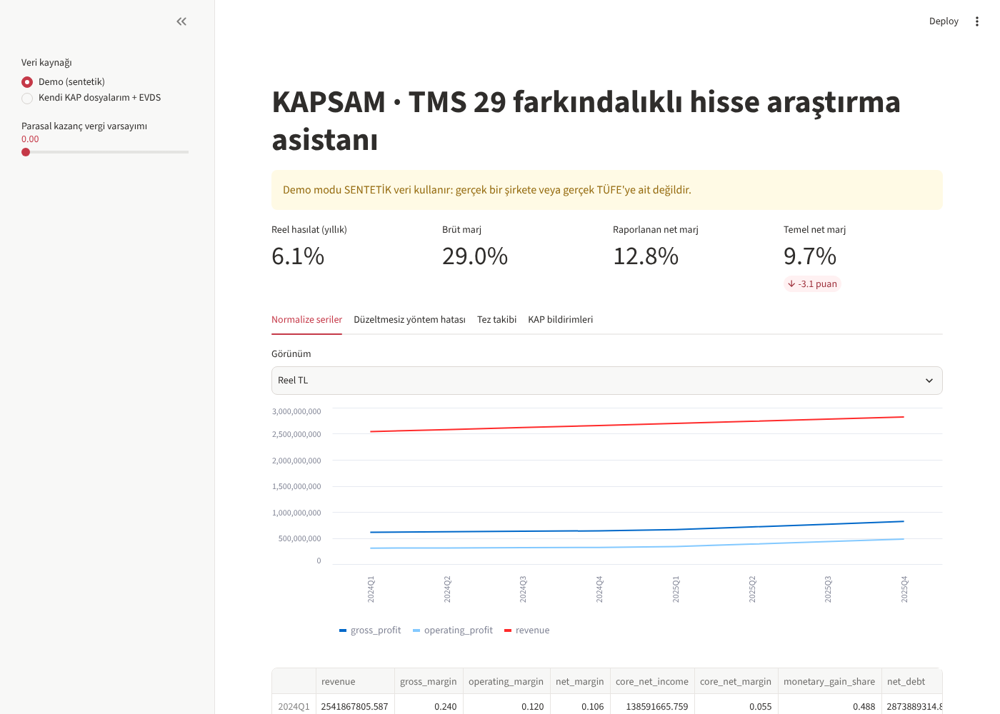
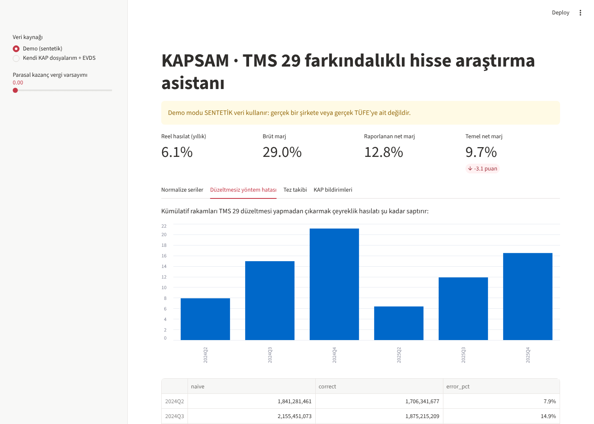

# KAPSAM

**KAP bildirimlerini ve TMS 29 enflasyon muhasebesini anlayan, yapay zekâ destekli hisse araştırma asistanı.**

Turkcell *Yarının Teknoloji Liderleri 2027*: Fintek ve Dijital Ticaret teması.



## Hangi sorunu çözüyor?

2023 sonundan beri Borsa İstanbul şirketleri finansal tablolarını **TMS 29 (IAS 29)** ile enflasyona göre düzelterek yayımlıyor. Bu durum analistlerin günlük işini üç noktada bozuyor:

1. **Her rapor farklı bir TL ile yazılıyor.** Raporlar, karşılaştırmalı dönemler dahil, raporlama tarihinin satın alma gücüyle sunuluyor.
2. **Çeyreklik rakam basit çıkarmayla bulunamıyor.** 9 aylık rakamdan 6 aylık rakamı doğrudan çıkarmak sonucu sistematik olarak şişiriyor. Demo verisinde bu hata %6 ile %21 arasında çıkıyor (aşağıya bakın).
3. **Kârın önemli kısmı operasyondan gelmeyebiliyor.** *Net parasal pozisyon kazancı* kârı şişirebiliyor.

KAPSAM bu düzeltmeleri otomatik ve denetlenebilir biçimde yapıyor. KAP bildirimlerini sınıflandırıp önem skoru veriyor ve analistin yatırım tezini KPI'larla takip ediyor.



## Modüller

| Modül | Dosya | Ne yapar |
|---|---|---|
| Veri içe aktarma | `kapsam/data/statements.py` | KAP'tan indirilen Excel/CSV tabloları okur; Türkçe kalem adlarını standart hesap koduna eşler; `2025/9`, `30.09.2025` gibi dönem gösterimlerini anlar |
| Makro veri | `kapsam/data/evds.py` | TCMB EVDS API'sinden TÜFE (`TP.FG.J0`) ve USD/TRY (`TP.DK.USD.A.YTL`) verisini çeyrek sonuna indirger |
| **TMS 29 motoru** | `kapsam/normalize/tms29.py` | Kümülatiften çeyreğe ayrıştırma, reel (baz tarih) seri, TMS 21 par. 42'ye göre USD çevrimi, parasal kazançtan arındırılmış temel kâr, KPI'lar |
| Sayısal doğrulama | `kapsam/validate.py` | Bilanço denkliği ve brüt kâr kimliği kontrolü; özetlerdeki her sayının kaynak metinde geçtiğini doğrulama (halüsinasyon önlemi) |
| Bildirim sınıflandırıcı | `kapsam/ai/classifier.py` | 11 KAP bildirim kategorisi, yön (+/−), tutarın piyasa değerine oranıyla ağırlıklandırılmış önem skoru |
| LLM katmanı | `kapsam/ai/llm.py` | Sağlayıcıdan bağımsız, yalnızca kaynağa dayanan JSON özet; doğrulamayı geçemeyen çıktıyı `DOĞRULANMADI` olarak işaretler |
| Tez takibi | `kapsam/thesis.py` | Analist tezini kurallara bağlar; sonucu GÜÇLENDİ / ZAYIFLADI / KARIŞIK olarak verir |
| Pano | `app.py` | Streamlit arayüzü |

Mimari şema için: [docs/architecture.md](docs/architecture.md)

## Kurulum ve çalıştırma

```bash
pip install -r requirements.txt
python data/demo/generate_demo.py      # sentetik demo verisini üret
python -m kapsam.cli                   # uçtan uca demo çıktısı (terminal)
streamlit run app.py                   # pano
pytest -q                              # 27 birim testi
```

### Gerçek veriyle kullanım

1. EVDS'den ücretsiz API anahtarı alın ve `EVDS_API_KEY` ortam değişkenine tanımlayın.
2. KAP'ta şirketin finansal rapor sayfasından tabloları Excel olarak indirin. Her rapor ayrı bir dosya olmalı.
3. Panoda **"Kendi KAP dosyalarım + EVDS"** seçeneğini işaretleyip dosyaları ve dönemleri girin.

> **Demo verisi sentetiktir.** `data/demo` içindeki şirket (DEMO) ve TÜFE patikası gerçek değildir; yalnızca motorun matematiğini doğrulamak için üretilmiştir. Testler, motorun sentetik verideki "gerçek" çeyreklik hasılatı ve %1,5'lik reel büyümeyi birebir geri elde ettiğini kontrol eder.

## Sorumluluk reddi

KAPSAM bir araştırma ve karar destek aracıdır; yatırım tavsiyesi vermez.

## Lisans

MIT
