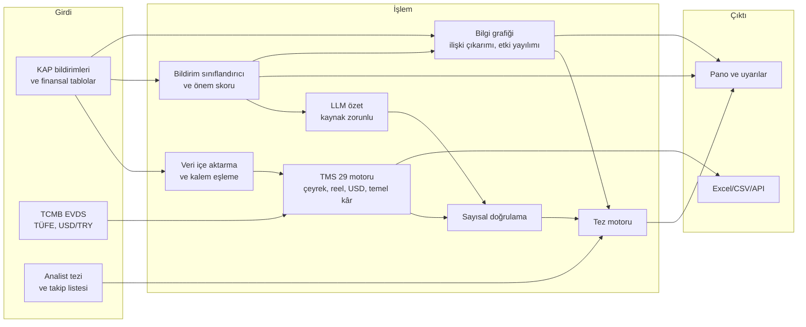

# KAPSAM Mimarisi

## TMS 29 matematiği

- Raporlama tarihi R, TÜFE endeksi CPI olsun.
- Çeyreklik akış: `Q_R = YTD_R − YTD_{R−1} × CPI_R / CPI_{R−1}` (aynı mali yıl içinde).
- Reel seri (baz tarih B): `X_B = X_R × CPI_B / CPI_R`
- USD (TMS 21 par. 42, kapanış kuru): `X_USD = X_R / USDTRY_R`
- Temel net kâr: `NI − NMG × (1 − t)`. Burada NMG net parasal pozisyon kazancı, t ise vergi varsayımıdır.

## Yol haritası (prototip → MVP)

- [x] TMS 29 motoru ve birim testleri
- [x] Kural tabanlı bildirim sınıflandırıcı
- [x] Kaynak doğrulamalı LLM arayüzü
- [x] Streamlit panosu
- [x] Reel İNA, ters İNA, duyarlılık ve çarpanlar (v0.2)
- [x] HTML araştırma notu ve formüllü Excel modeli (v0.2)
- [x] Şirketler arası karşılaştırma (v0.2)
- [x] Bilgi grafiği: ilişki çıkarımı, etki yayılımı, benzer şirket, araştırma önceliği, sıralama metrikleri, olay çalışması (v0.3)
- [x] KG modelleri: kişiselleştirilmiş PageRank, TransE, CAR'dan katsayı kalibrasyonu, bootstrap ile model karşılaştırma (v0.4)
- [x] Otomatik gerçek veri hattı: EVDS, piyasa fiyatları, KAP dosyaları, zamanlanmış GitHub Actions, durum sayfası (v0.5)
- [x] Gerçek KAP Excel düzeni, 3 aylık çapraz kontrol, nakit akışından satış/sermaye, `kap-ekle` (v0.6)
- [x] İlk gerçek veri: BİM 2025/09–2026/09, gerçek TÜFE ve TCMB kurları; ters İNA ile fiyatlanan marj (v0.7)
- [x] Herhangi bir hisse için tablo kaynağı, birikimli geçmiş, `analiz` ve `tarama`; 8 şirketle gerçek tarama (v0.8)
- [x] Tüm BIST: otomatik evren, banka/sigorta tablo biçimleri (nominal mod), akıllı rapor takvimi, günlük limit, aranabilir tarama sayfası, finansal sektör notu (v0.9)
- [x] Tüm BIST'te ilk tam tur (629 hisse, 0 hata), BIST-30 takip listesi, 25 gerçek KAP olayı, kaynaklı ilişki ağı
- [x] Tüm hisselerin fiyatı; risk tablosu, korelasyon ve kovaryans (örnek + Ledoit–Wolf), sektör korelasyonu (v0.9)
- [x] Her hisse aynı ayrıntıda: 607 şirket için not + Excel + piyasa riski; tüm hisselerde günlük Ledoit–Wolf; ağır çıktılar geçmişsiz 'rapor' dalında
- [ ] Gerçek ilişki ağı: faaliyet raporları ve KAP "yeni iş ilişkisi" bildirimlerinden
- [ ] KAP bildirimlerinin otomatik toplanması (zamanlanmış görev)
- [ ] XBRL doğrudan okuma
- [ ] 1.000 etiketli bildirimle sınıflandırıcı ince ayarı
- [ ] Sektör medyanlarıyla göreli değerleme
