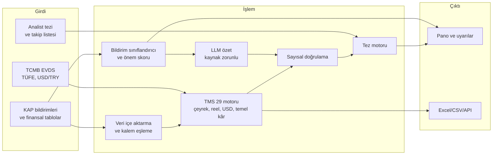

# KAPSAM Mimarisi

## TMS 29 matematiği

- Raporlama tarihi R, TÜFE endeksi CPI olsun.
- Çeyreklik akış: `Q_R = YTD_R − YTD_{R−1} × CPI_R / CPI_{R−1}` (aynı mali yıl içinde).
- Reel seri (baz tarih B): `X_B = X_R × CPI_B / CPI_R`
- USD (TMS 21 par. 42, kapanış kuru): `X_USD = X_R / USDTRY_R`
- Temel net kâr: `NI − NMG × (1 − t)`. Burada NMG net parasal pozisyon kazancı, t ise vergi varsayımıdır.

## Yol haritası (prototip → MVP)

- [x] TMS 29 motoru ve birim testleri
- [x] Kural tabanlı bildirim sınıflandırıcı
- [x] Kaynak doğrulamalı LLM arayüzü
- [x] Streamlit panosu
- [ ] KAP bildirimlerinin otomatik toplanması (zamanlanmış görev)
- [ ] XBRL doğrudan okuma
- [ ] 1.000 etiketli bildirimle sınıflandırıcı ince ayarı
- [ ] Çoklu şirket ve sektör karşılaştırması
